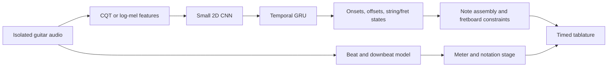

# Guitar transcription research plan

Prepared 7 October 2026. This is a proposed research design, not a claim that the proposed model outperforms existing systems.

Budget update, 8 October 2026: stage 1 uses pretrained inference on 12 short GuitarSet excerpts, with models run sequentially on an RTX 3050 6 GB / approximately 8 GB RAM laptop. The initial stage-2 training preference is 5 epochs and at most 500 optimizer steps, with batch size 4, 2-second crops and early stopping. These limited-budget runs will be reported separately from converged training comparisons. Check acoustic preprocessing parity before treating errors from a third-party MT3 port as gaps in the original model.

Stage 2 implementation update: the 935,081-parameter CQT/CNN/bidirectional-GRU model completed five epochs and 500 updates on 48 progression-1 recordings, with 12 progression-2 recordings for model selection. It predicts notes and string/fret positions. The original progression-3 excerpts remain the evaluation set. Training plus validation took about 60 seconds; the report, history, checkpoints, MIDI and timed tablature are in `outputs/cnn_gru`. A decoder repair was validated without extra training. The prototype remains below the pretrained baselines in note accuracy and uses future context; it is a starting point for matched-budget experiments.

Stage 3 implementation update: a 937,897-parameter CNN-transformer completed the same five-epoch / 500-update budget with unchanged data, cache, crop recipe, loss, optimizer and heads. Its four-layer temporal encoder replaces the GRU; the shared initial weights are identical and total parameters differ by about 0.3%. Best validation onset F1 is 0.516 versus 0.554 for the GRU. Paired evaluation and fresh same-device timings are preserved in `outputs/cnn_transformer`. The GRU remains the current choice under the validation criterion; this single-seed result is not a universal architecture ranking.

Stage 4 update, 9 October 2026: the frozen GRU was stress-tested with stronger analytic EQ/drive and an unseen combined chain, plus twelve independent EGSet12 electric recordings. One augmentation trial completed five epochs and 500 updates on the same training sources, mixing clean/EQ/drive views. Its synthetic-effect average did not improve, and real-electric onset F1 changed from 0.291 to 0.275. The original GRU remains the default. Full condition scores, external-data provenance and the negative augmentation result are in `outputs/robustness`. The real-data gap changes performer, composition, setup and annotation provenance together; it does not identify timbre as the sole cause.

Stage 5 update, 9 October 2026: pitch-preserving beam search adds string-occupancy, fret-span, barre/finger-group and hand-movement checks. Its acoustic weight is selected on progression-2 reference notes. On the progression-3 examples, oracle-note string-aware onset F1 is 0.834. Applying it to CNN-GRU note events retains pitch onset F1 0.522 while string-aware F1 changes from 0.431 to 0.424; configured violations on assigned positions disappear, with three unresolved notes retained explicitly. Timed tabs, audio, constraint metrics and retab/transcribe commands are in `outputs/fingering` and `fingering/`. These proxies need musician validation and do not fix acoustic transcription or guarantee a preferred fingering.

Stage 6 update, 10 October 2026: the official pretrained Beat This small0 model supplies beats/downbeats with zero new training. A pitch-class-template/Viterbi chord baseline and deterministic per-bar straight/triplet quantization produce editable MusicXML, score JSON/CSV and synchronized local review/correction files. Four oracle/predicted note/beat combinations isolate acoustic, rhythm and conversion errors. Beat/downbeat F1 is 0.661/0.578 on twelve test excerpts; provisional meter agreement is about 50%, with stronger performance on comping than solos. Small0 trained on GuitarSet and all current reference excerpts are 4/4, so these are integration diagnostics. Chord reduced-vocabulary duration accuracy is 0.488 with oracle inputs and 0.249 end to end. Raw note intervals remain intact; quantized intervals and uncertainty flags are separate. All sixty scores pass MusicXML schema and attack/bar-conservation checks. The next product step requires independent rhythm data and musician review of written durations before claiming robust meter/notation or proceeding to mixtures/streaming. Artifacts are in `outputs/rhythm` and the implementation is in `rhythm/`.

Stage 7 update, 10 October 2026: the mixtures branch adds the official frozen htdemucs_6s guitar separator, without new training. Twelve GuitarSet excerpts are paired with deterministic bass/keyboard/percussion rendering at +6, 0 and -6 dB guitar-to-backing ratios. The 144-record experiment includes per-level gain-matched isolated targets, clean-through-separator and raw accompaniment-only controls. Mixture onset F1 of 0.313/0.215/0.137 rises to 0.484/0.465/0.437 after separation. The raw transcriber emits 535 notes on no-guitar inputs. Measured separator GPU tensors peak at 619.4 MiB, with models executed sequentially. A song-file command now exports separated guitar, constrained notes/tabs and optional editable MusicXML; beats use the original mix. Protocol, synthetic-data confounds, raw-versus-MIDI timing differences and sample/hash checks are documented in `outputs/mixtures` and `mixtures/`. Independent real mixtures with known guitar stems are still needed; this stage neither establishes full-song generalization nor causal streaming.

Stage 8 update, 11 October 2026: the streaming branch adds a 931,145-parameter causal CNN-GRU, right-edge log-frequency STFT, frame-local normalization, persistent convolution/GRU state and immutable incremental note events. Initial 100-update weights were discarded after target-grid and EOF retrigger fixes; the corrected model trained four epochs / 400 updates, maintaining the total 500-update budget. Decoder calibration uses validation only with zero further updates. Onset F1 is 0.116 across 20/40/80 ms packet replays versus 0.525 for the frozen offline reference. Correctly matched onset delivery p50/p95 is 87/144 ms for 20 ms packets, conditional on only 70 matched notes. The same source intervals survive different packet sizes, but accuracy is insufficient to replace the offline pipeline. Native capture/resampling, drivers, separation and rhythm remain outside the replay contract. Causality, boundaries and event immutability are tested; the next priority is diagnosing representation/decoder/training quality before a microphone product. Results and the event-clock viewer are under `outputs/streaming` and implementation under `streaming/`.

Stage 9 update, 11 October 2026: frozen-model diagnosis adds zero training epochs and zero optimizer updates. Validation exact string/fret frame F1 is 0.0903 at the selected activity threshold, versus 0.5421 for active/inactive decisions; acoustic fret/state accuracy is the larger observed weakness. A state/onset oracle factorial holds backdate fixed at either 0 or 60 ms. At 0 ms, predicted/predicted, predicted/reference-onset, reference-state/predicted and reference/reference note F1 are 0.08372/0.11585/0.85825/0.96121; at 60 ms they are 0.11105/0.14276/0.24666/0.35837. Reference inputs are explicit privileged diagnostics and never enter ordinary inference. The zero-backdate oracle still misses 82 of 753 notes, all repeated same-pitch events. Resetting causal context every two seconds gives no strong evidence that state drift alone accounts for the gap. Eighteen decoder-only configurations select state EMA alpha 0.5, four-frame confirmation and 60 ms backdate on validation, improving onset F1 0.11105 to 0.11909. On the reused progression-3 excerpts, onset F1 instead changes 0.11636 to 0.11487; the repair is not promoted, no weights are changed, and the offline CNN-GRU remains the default. Artifacts and file-replay commands are under `outputs/diagnosis9` and `diagnosis9/`. Next budgeted work is a tiny overfit sanity check followed by matched causal frontend/normalization/label-delay ablations, with an independent recording test after validation choices are frozen; stage 9 spends no new training compute.

Stage 10 update, 11 October 2026: the separate acoustic trial uses exactly 500 new updates: 100 on one fixed four-crop training batch, then two fresh matched 200-update models. The sanity gate passes with active-fret accuracy 0.9722, exact-state F1 0.9103 and state loss 4.98% of initial; it establishes four-crop learning, not generalization, and never initializes the comparison models. Their seed-42 weights, 800 crop/gain descriptors, training normalization, architecture and optimizer are identical. One arm translates all supervised heads by six frames before cropping; publication-time source compensation subtracts that delay once for all note boundaries while retaining actual availability/delivery. Both final step-200 models use fixed decoder parameters and the same original-source validation span. Exact-state F1 rises from 0.05537 to 0.06044 and note-onset F1 from 0.03814 to 0.05262; delay60 is selected for development only, with weak absolute quality and no promotion. No test audio is evaluated. Recorded optimization phases total 37.4 seconds, peak allocated training GPU tensors are 288.3 MiB, and 225 tests plus independent 24-case probability/export audits pass. The implementation/results are in acoustic10/ and outputs/acoustic10. The next separately budgeted variable is past-only spectral resolution with explicit context/delivery cost; fresh recordings remain necessary for an improved-generalization claim.

Stage 11 update, 12 October 2026: the matched window trial spends 500 new updates, 250 per fresh model over five epochs, with zero new sanity updates. Past-only 128 ms/2048-point and 256 ms/4096-point Hann windows retain identical 216-bin features, model parameters and right-edge hop grid. Both use shared 130 ms target delay, 26-frame masks, fresh initialization and 1,000 sampled crop/gain descriptors; per-arm normalization uses training frames only under the same original recipe. This compares window length under fixed supervision, changing frequency spacing, temporal smearing and Hann-center alignment together. On the twelve selection/validation clips, exact-state F1 is 0.06993 versus 0.06066 and note-onset F1 0.06663 versus 0.02863, favoring short128. Auxiliary low-register macro F1 also favors the short window, 0.11563 versus 0.07680. Neither model is promoted, and no test data is inferred. Actual optimizer counters confirm 250 steps per arm; recorded training totals 39.5 seconds with roughly 281 MiB allocated tensor peaks. All 279 tests and independent 24-case probability/export audits pass. Results are in spectral11/ and outputs/spectral11. The next separately budgeted variable is frame-local normalization, keeping the short window and remaining controls fixed; this outcome neither identifies normalization as the cause nor proves long windows are universally inferior.

Stage 12 update, 12 October 2026: the frame-local normalization trial reuses the exact frozen stage-11 eight-group short-window control and trains one fresh one-group CNN-GRU for 250 new updates. Both compared models have 250 lifetime updates, identical 931,145 initialized parameters, the same 1,000 crop/gain draws, features, timing, loss and optimizer recipe. Changing only CNN GroupNorm group count preserves within-frame/batch-independent causality; projection LayerNorm is unchanged. All twelve current control probability sets are bit-identical to their earlier counterparts, while inference clocks are measured again. Exact-state F1 rises 0.06993 to 0.07206 and note-onset F1 0.06663 to 0.07790; group1 is selected for development only, with weak absolute quality and slightly worse weighted state loss. No test inference, new sanity gradients, control retraining or product promotion occurs. New treatment training takes 24.3 seconds with 280.1 MiB allocated tensor peak. All 334 tests and independent 24-case probability/export/reuse audits pass. Results and the required group-aware model loader are under normalization12/ and outputs/normalization12. The next separately budgeted question is matched optimization dose using preserved parent weights/optimizer states, rather than assuming normalization explains the gap.

Stage 13 update, 12 October 2026: the continuation-dose trial preserves both 250-update parents, restores their exact model/AdamW moment states and adds 250 updates per arm, spending 500 new updates total. Each model reaches 500 lifetime updates after five additional sampled-crop epochs. Stored-end learning rate 0.0001 is held constant; fresh common Torch seed 43 and AMP scale 1024 are declared because historical RNG/scaler state was not saved, so this is not an exact uninterrupted stochastic resume. Data seed 42 continues matched epochs 6–10, while features, grouping, masks, label/source timing and decoder stay fixed. Eight-group state/onset F1 rises 0.06993/0.06663 to 0.07791/0.10124; one-group rises 0.07206/0.07790 to 0.07635/0.09152. Both low-register pitch diagnostics decline. Final-only validation selection chooses group8_500, with a small one-seed margin and no promotion or test inference. All 24 parent replays reproduce archived probabilities bit-for-bit. New optimization phases total 35.2 seconds with roughly 281 MiB tensor peaks. All 417 tests and independent 48-case source/optimizer/probability/export audits pass. Results are in optimization13/ and outputs/optimization13. The next low-compute check is delayed-oracle source-clock verification and frozen-model decoder calibration with zero new training; raw-head weakness and fresh-recording requirements remain explicit.

## Recommended direction

Start with **polyphonic, six-string guitar audio to timed notes and playable tablature**, using a CNN-GRU acoustic model. Establish an offline baseline on isolated guitar before adding electric-guitar effects, accompaniment, or streaming. Use MT3 as a reference for note transcription, and TabCNN/FretNet as references for tablature. Compare a small transformer encoder with the same features, output heads, decoder, and data as the CNN-GRU.

The central research question should be: **Can a compact guitar model retain useful note and tablature accuracy on unseen guitar tones while reducing measured processing cost and, in a causal variant, streaming delay?**

Training a small model's weights from scratch is feasible as a research experiment. Learning accurate transcription requires aligned audio and labels; a collection of unlabeled songs does not provide that supervision by itself. Reproducing full multitrack MT3 training is a separate, substantially larger project. Instrument specialization may help efficiency, but does not guarantee better accuracy: MT3's joint training specifically helped low-resource guitar transcription.

## Define the outputs before choosing the network

| Output | What it answers | Required information |
| --- | --- | --- |
| Song identity | Which recorded song is playing? | Recording lookup/fingerprinting; independent of transcription |
| Chord chart | Which harmony is present over each interval? | Chord labels, boundaries, vocabulary, optionally bass/inversion |
| Note transcription | Which pitches occur, and when? | Onsets, offsets, overlapping notes, instrument attribution if mixed |
| Performance tablature | Which string/fret did the guitarist use? | String/fret supervision; sometimes acoustically ambiguous |
| Playable tablature | How can these notes be played on this guitar? | Tuning, fretboard constraints, sequence context, playing preferences |
| Rhythm notation | How are events grouped and written in bars? | Beat/downbeat map, meter, quantization and notation rules |
| Arrangement | How should another instrument play this song? | Musical selection, voicing, range and difficulty decisions |

Transcribing the existing guitar part and arranging a piano or full band recording for guitar are different objectives. Version 1 should target the existing guitar performance. If the intended initial product is only a chord chart, use a simpler chord-recognition track rather than requiring full tablature.

## What MT3 actually provides

MT3 uses a T5-style encoder-decoder transformer. Log-mel audio frames are encoded; a greedy autoregressive decoder emits MIDI-like instrument, pitch, note-on/off and time events. Its experiments use independent 2.048-second segments, 10 ms absolute time tokens, and a tie mechanism to reconnect active notes across segments. The vocabulary does not supply string/fret positions or a written score's meter.

The released frontend defaults are 16 kHz audio, a 2,048-sample FFT, a 128-sample hop and 512 mel bins. These are reference settings for reproducing MT3 preprocessing, not requirements for a guitar model. [MT3 paper](https://arxiv.org/html/2111.03017), [frontend source](https://github.com/magenta/mt3/blob/main/mt3/spectrograms.py).

The two local reference papers are `Papers/3989_mt3_multi_task_multitrack_musi.pdf` and `Papers/000030.pdf`; the latter is the 2021 piano predecessor, not the multitrack MT3 paper. Keep their segment lengths, vocabularies and reported results distinct.

The official repository offers pretrained inference and says training is not easily supported. Begin by reproducing inference and evaluation on a documented subset; distinguish that from reimplementing the network and from reproducing the original training run. [Official repository](https://github.com/magenta/mt3).

## Proposed acoustic model

### Starting configuration to test

- Resample custom-model audio consistently, for example to 22.05 kHz. Preserve MT3's own preprocessing when running its checkpoint.
- Use a nominal feature hop around 10 ms. This is output sampling density, not an end-to-end latency guarantee.
- Start with one CQT branch, using 24 or 36 bins per octave over an appropriate guitar frequency range. Run an otherwise equivalent log-mel baseline.
- Use three small convolution blocks, for example 32/64/128 channels. Reduce frequency resolution cautiously and retain time resolution; preserve pitch-position information rather than averaging away the entire frequency axis.
- Project each frame to approximately 256 features.
- Use two bidirectional GRU layers, initially around 128 units per direction, for the offline baseline. These numbers are tunable starting points.
- Predict six fret-state distributions. For maximum fret 24, each string has 26 classes: inactive plus frets 0 through 24.
- Predict onset and offset probabilities for string/fret candidates so repeated plucks can be split even when there is no silent frame between them.
- Add an auxiliary multi-pitch head to improve and independently assess acoustic pitch detection.
- Add continuous pitch deviation/contour outputs only after the discrete baseline works and suitable labels have been checked.

For fixed tuning, an unbent note satisfies `MIDI pitch = open-string MIDI pitch + fret`. Use this relationship to check or constrain outputs. With bends, distinguish the underlying fretted position from its time-varying sounding pitch.

Start with weighted cross-entropy for fret states and weighted binary cross-entropy for onsets, offsets and auxiliary pitch. Mask missing labels. A pitch/tab consistency term and a masked Huber loss for continuous pitch or timing residuals are later ablations, not mandatory ingredients. Tune decoding thresholds on validation data only.

Convolutional-recurrent onset/frame models have an established transcription precedent; a CNN-RNN is a defensible baseline, rather than a speculative alternative with no prior support. [Onsets and Frames](https://arxiv.org/abs/1710.11153).

### What to compare

| Candidate | Role | Important restriction |
| --- | --- | --- |
| CNN + bidirectional GRU | First custom offline model | Uses future context; cannot demonstrate causal streaming |
| Same CNN + small transformer encoder | Controlled architecture comparison | Same heads, data, features and decoder; report compute and context |
| Causal CNN + unidirectional GRU | Streaming experiment | Audit frontend, convolution padding, state, and lookahead |
| MT3 checkpoint | General note/instrument reference | Has no native string/fret output; document training overlap |
| TabCNN / FretNet | Guitar-specific references | Match evaluation targets and split provenance |
| Basic Pitch | Convenient isolated-instrument pitch baseline | Does not itself produce guitar fingering or meter |

Do not infer that the GRU wins on speed or accuracy without measuring it. A framewise transformer also avoids autoregressive event decoding; that improvement is partly an output-design choice, not an RNN-only property.

For a multitrack research path, study YourMT3+ as an additional reference: it explores enhanced encoders, instrument-group decoding and cross-dataset stem augmentation. Check actual code/checkpoint availability before scheduling a reproduction. [YourMT3+ paper](https://arxiv.org/html/2407.04822v1).

## Choosing the audio representation

| Representation | Useful property | Limitation to test |
| --- | --- | --- |
| Log-mel STFT | Broad spectral/timbre cues; familiar baseline | Bins are not aligned directly to musical semitones |
| CQT | Log-frequency spacing supports musical pitch structure | Long low-frequency windows blur attacks and complicate streaming |
| Harmonic CQT | Relates energy at fundamentals and harmonic multiples | Extra computation; harmonics overlap in polyphony |
| Multi-resolution STFT | Short windows for attacks, long windows for pitch resolution | Additional feature processing and fusion |
| Chroma | Compact pitch-class representation for chord estimation | Discards octave/register; insufficient by itself for exact tabs |

Do not assume CQT removes amp/EQ variation. It changes the representation, while timbre variation still changes harmonic amplitudes. Compare CQT, log-mel and a combined branch sequentially. Add HCQT or multi-resolution STFT only if the observed error pattern justifies their cost. TabCNN's original implementation provides CQT, mel, combined and STFT options. [TabCNN](https://github.com/andywiggins/tab-cnn).

## Notes to playable tabs

An E4 can be played on different strings and frets. Pitch alone cannot guarantee the exact physical position used in the original performance. Timbre and phrase context can help, but multiple plausible solutions can remain.

Build a small dynamic-programming or beam-search decoder that scores acoustic confidence, pitch agreement, hand-position movement, fret span and string conflicts. Maintain sustained-note constraints, permit realistic barre shapes, and let open strings and preferred positions be configurable. Avoid an unconditional rule that always chooses the lowest fret.

Separate two evaluations:

1. Exact string/fret recovery, when ground-truth performance positions exist.
2. Pitch-preserving, playable alternatives, including musician preference, when several fingerings are valid.

Run the decoder on reference pitches first. This oracle-pitch experiment exposes fingering errors independently of audio transcription. Then run it on predicted pitches. For later learned fingering work, study the 2025 Fretting-Transformer, which treats MIDI-to-tab mapping as a separate symbolic task. [Fretting-Transformer](https://arxiv.org/abs/2506.14223).

## Rhythm and chord stages

Use a separate pretrained beat/downbeat model initially, for example Beat This, and evaluate it independently. Estimate meter over multiple bars using beat grouping, accent patterns and subdivisions. Preserve changes of tempo and meter, pickups and confidence. [Beat This](https://github.com/CPJKU/beat_this).

Counting detected beats between downbeats does not determine every time signature. A tracker may represent 6/8 with two dotted-quarter beats; subdivisions distinguish compound meter. The denominator and a notation convention can remain ambiguous from audio, so permit a user correction.

Keep raw onset/offset seconds separate from score durations. Quantize to the inferred beat grid afterward, considering swing, tuplets, ties and rests. Audible decay is not always the intended written duration. Test the notation stage with reference notes and reference beats before attributing score errors to the acoustic model.

For chord charts, start with pitch-class features and a temporal chord classifier, then smooth boundaries and align them with beats where appropriate. Define a modest vocabulary first, such as major/minor plus a no-chord class, expanding to sevenths and inversions only with supporting labels. Notes played sequentially in an arpeggio can imply a chord; instantaneous frequency peaks are not enough. Also distinguish the full song's harmony from the subset voiced by one guitar. [Chord-estimation framework](https://arxiv.org/abs/1709.07153).

## Data strategy and robustness

GuitarSet supplies acoustic guitar recordings with string-level notes, pitch contours, chord annotations and beat information. Its 360 roughly 30-second excerpts amount to approximately three hours: useful for a baseline, insufficient as sole evidence of electric-guitar robustness. Read annotation provenance carefully; its performed chords are partly derived using lead-sheet information. [Dataset authors](https://guitarset.weebly.com/).

Use SynthTab to investigate synthetic pretraining with known tablature positions. Synthetic rendering helps supply labels at scale, but does not replace a held-out real recording test. [SynthTab](https://github.com/yongyizang/SynthTab).

Proposed training progression:

1. Fit and inspect GuitarSet examples with reliable labels.
2. Add synthetic string/fret-labelled material, retaining its source identities.
3. Vary EQ, gain, compression, cabinet responses, room response and amplifier/effects parameters.
4. Fine-tune and evaluate on real electric guitar, including clean, crunch, distortion, palm-muted and sustained playing.
5. Add accompaniment only after isolated-guitar performance is understood.

Distortion is nonlinear: processing the whole dry polyphonic guitar through an amplifier differs from independently distorting each string and summing. Include realistic processing of the full guitar signal when possible. Compensate any processing delay that shifts label alignment. Delay effects introduce audible repetitions and ambiguous event targets; leave these for a separate experiment rather than assuming they preserve onset labels harmlessly.

Pitch-shifting requires consistent changes to pitch and/or tuning/fret labels. Reject combinations outside the supported fretboard. Do not use a pitch-shift augmentation that silently preserves incompatible tablature labels.

Effects-based augmentation is already prior work. The DAFx 2024 study tests real guitar-tone/effect diversity and an external performance dataset. A project can extend this through held-out effect combinations, guitars, processing chains, mixtures or a measured latency budget; adding generic distortion alone should not be presented as a new contribution. [DAFx paper](https://dafx.de/paper-archive/2024/papers/DAFx24_paper_99.pdf).

## Adding full songs

Evaluate three distinct conditions: reference isolated guitar, an estimated guitar stem, and the original mixture. Their differences expose how much error comes from accompaniment and separation.

Try a guitar-capable separation model as an optional frontend. Standard four-stem Demucs produces vocals/drums/bass/other; its experimental six-source model adds guitar and piano. A guitar stem can still merge several guitars or contain leakage. Measure downstream transcription accuracy rather than relying only on how clean the stem sounds. [Demucs authors' repository](https://github.com/facebookresearch/demucs).

Train with varied accompaniment levels and some separation artifacts, but retain unprocessed real recordings for evaluation. A specialist remains a polyphonic mixture problem when it receives a full band recording. Its smaller output space does not automatically solve source attribution.

## Candidate gaps and priority

| Gap or product mismatch | Proposed experiment | Priority |
| --- | --- | --- |
| Unseen electric tones/effects | Label-aware augmentation; held-out player/guitar/processing chain | Highest |
| No explicit guitar positions | String/fret supervision plus constrained sequence decoding | Highest |
| Accuracy versus processing cost | Controlled CRNN/transformer comparison, fixed batch/context/hardware | High |
| Independent short-window behavior | Notes near crop boundaries; overlap versus retained causal state | Medium |
| Integer pitch misses bends/vibrato | Continuous deviation/contour head with reliable labels | Medium/later |
| Time quantization | Subframe onset/offset residuals with high-quality alignment | Later |
| Missing written meter and bars | Separate rhythm/notation stage; oracle-input evaluation | Product stage |

Discrete outputs are not intrinsically defective. Pitch class and fret index are naturally discrete. Framewise classifiers are also discrete unless explicit regression/contour outputs are added. MT3's 10 ms timing grid should not be assumed to dominate its errors: test timing errors and annotation quality first. Continuous guitar contours are already explored by FretNet. [FretNet paper](https://arxiv.org/abs/2212.03023), [author code](https://github.com/cwitkowitz/guitar-transcription-continuous).

## Evaluation protocol

Freeze splits before cropping or augmentation. Keep alternate renders and effects versions of the same source performance together. Use player-held-out tests for unseen performers and a separate composition-held-out test for unseen musical material. A player split alone still permits the same compositions across partitions.

For reproducing a paper, first retain its published split. For controlled custom-model comparisons, train all compared models on the same new splits. A released checkpoint may already have trained on a new test fold; do not claim unseen-data performance just because the fold is new to your own model. Document dataset and pretraining provenance, and add a genuinely external real-electric test.

Record note onset F1, onset-plus-offset F1, frame multi-pitch precision/recall/F1, string/fret note F1, and exact-fingering errors conditional on correctly detected pitch. State pitch/time tolerances explicitly. Report bass/guitar confusion in mixtures, repeated-note errors, sustain/offset errors, octave errors, and crop-boundary errors separately. Use the same underlying note evaluator for MT3 and custom outputs.

For the downstream stages record beat/downbeat F1, meter-segment accuracy with boundaries, chord weighted duration accuracy under a specified vocabulary, pitch preservation, infeasible fingerings and hand movement. Include musician inspection of a fixed sample of playable alternatives; exact agreement with one reference fingering is not a complete playability metric.

Measure real-time factor as processing time divided by audio duration, with feature extraction and decoding included. State CPU/GPU, batch size, audio length and warm-up. For a full-song pipeline measure separation too. For streaming additionally report algorithmic lookahead, buffer size and median/p95 time until an onset is emitted. Fast offline processing does not establish low live latency; offsets also require evidence that a note ended.

Use several training seeds for the final comparison and summarize variation across recordings and held-out domains. Do not repeatedly tune against the external test set.

## Experiment sequence and deliverables

| Stage | Work | Deliverable / decision |
| --- | --- | --- |
| 1. Baselines | Run MT3 inference; establish a guitar baseline; inspect 10-20 excerpts spanning error types | Reproducible evaluation script, split manifest and error taxonomy |
| 2. Custom offline model | Verify label alignment; overfit a tiny subset as a sanity check; train CNN-GRU on fixed split | First timed notes and tabs with measured accuracy |
| 3. Controlled architecture comparison | Swap temporal encoder for a small transformer; retain frontend, labels and decoder | Evidence for choosing the temporal model |
| 4. Robustness | Add synthetic/effect data; evaluate held-out real electric domains | Per-domain gains or failures, with augmentation ablation |
| 5. Fingering | Compare unconstrained and constrained output; use oracle and predicted pitches | Separate acoustic versus fingering error analysis |
| 6. Product rhythm | Add beat/downbeat, meter, chord chart and notation; verify with oracle inputs | Editable bars and synchronized tablature |
| 7. Mixtures | Frozen guitar separation; controlled accompaniment levels and downstream note scores | Separation helps synthetic mixtures; real-song validation still required |
| 8. Causal streaming | Causal frontend/normalization/model, persistent state and incremental event clocks | Low-compute file replay with explicit accuracy and matched-delivery limits |
| 9. Streaming diagnosis | Frozen head/context audits, oracle factorial and validation-only decoder search | Acoustic state/fret bottleneck identified; decoder repair not promoted |
| 10. Acoustic sanity and timing | Fixed-training-batch sanity; fresh matched immediate/delayed-supervision models within 500 total updates | Tiny batch can be learned; 60 ms delay gives small validation gain, no promotion |
| 11. Spectral window comparison | Matched past-only 128/256 ms windows under shared target timing and 500 total updates | Short window wins this validation comparison; accuracy remains weak |
| 12. Frame-local normalization | Exact reused eight-group control versus fresh one-group treatment; 250 new updates | Small validation gain; no product promotion |
| 13. Optimization dose | Restore both model/AdamW parents and add 250 updates each at stored-end rate | Both improve development note scores; low-register diagnostic falls; no promotion |
| 14. Frozen decoder calibration | Delayed-oracle source-clock verification and prespecified 27-candidate search per frozen model | Known 130 ms correction verified; zero extra backdate selected; onset F1 rises to 0.125/0.116 without training |
| 15. Residual acoustic diagnosis | Fixed selected decoder, one-to-one error associations, source-aligned state/pitch evidence and state/onset head interventions | State evidence dominates the remaining gap; direct state-to-pitch loss implemented/tested as a hypothesis, zero training |
| 16. Direct state-pitch supervision | Same-parent 250-update continuations with restored model/AdamW/scaler/RNG and identical new exposure | 500 new total; tiny state-F1 gain of 0.00091 but note-onset decline of 0.00360 versus control; no promotion |
| 17. Combined spectral scales | Fresh identical two-channel models: short/short versus short/long; five sampled epochs / 500 new updates total | Long plane raises note-onset F1 0.1098→0.1260 but lowers state F1 0.0709→0.0684; state-first rule retains short/short; no promotion |
| 18. Frozen head crossing | Reproduce Stage17 source decisions, cross state/onset outputs and separate activity, fret and aggregation policies | Zero training/inference; state swaps account descriptively for most note gain, while conditional fret accuracy falls; no hybrid selection |
| 19. Conditional-fret supervision | Same-parent250-update continuations, adding0.5-weight active-only fret CE to treatment | 500 new total; conditional fret accuracy rises18.79%→19.44% versus control, but state F1 falls0.0828→0.0749 and onset F1 falls0.1148→0.1136; control retained |
| Next diagnostic | Available versus actually supervised string/fret coverage, related to saved errors | Proposed zero training/inference; distinguish available frames, repeated presentations and unique supervised identities; no model selection |

For a semester-scale project, the first five stages are a coherent research contribution; product rhythm, mixtures and streaming can remain limited demonstrations. An illustrative schedule is 1-2 weeks for baselines/data checks, 2-3 for the custom model and architecture comparison, and 2-3 for robustness and fingering. Data collection, available compute and existing experience can change this substantially.

Stages 10–16 establish four-crop learning under the sanity settings, small timing/normalization gains, a negative long-window comparison, continuation-dose gains, a zero-training decoder calibration, an updated residual-error diagnosis and a mixed direct-pitch-loss result. Stage 15's privileged state intervention raises note-onset F1 far more than its onset intervention, supporting a state-loss hypothesis without establishing a training cause. Stage 16 tests that hypothesis from the same restored 500-update parent: control and treatment add 250 updates each and reach 750 lifetime updates. State F1 is 0.0866/0.0875, but onset F1 is 0.1634/0.1598, so the extra term is not a uniform improvement. The existing default stays unchanged.

Stage17 executes the combined-scale question with two fresh capacity-matched two-channel models, common initial weights/RNG, masks, 130 ms delay and fixed Stage14 decoding. Each receives250 new/lifetime updates over five sampled-crop epochs, spending500 total. Combined128/256ms features raise note-onset F1 from0.1098 to0.1260 but lower exact string/fret frame F1 from0.0709 to0.0684. The declared state-first rule selects short/short. The long plane changes spectral detail and past-window age together, not FFT spacing alone. These fresh250-update models are not a matched comparison with Stage16's750-update continuations.

Stage18 executes the frozen state/onset diagnosis with zero training and zero neural inference. All24 original source cases reproduce before24 crossed cases. State swaps change note-onset F1 by+0.0152 to+0.0155, while onset-only swaps change it by+0.0006 to+0.0009. At the existing decoder activity rule, occupancy recall rises64.73%→66.40%, but conditional fret accuracy falls20.98%→20.02%. Argmax, activity-rule mean and activity-rule pooled frame scores disagree in ranking, so the previous selection is retained. Crossed-head calibration mismatch prevents pure causal attribution or hybrid promotion.

Stage19 executes the conditional-fret proposal using500 new updates total:250 per arm from the same verified Stage17 short/short250-update parent, with full model/AdamW/scaler/RNG restoration, matched sampled epochs6–10 and constant0.0001. Each child reaches500 lifetime updates. The additional0.5-weight active-only CE improves conditional fret accuracy18.79%→19.44% versus control, but lowers primary argmax state F1 from0.0828 to0.0749 and note-onset F1 from0.1148 to0.1136. The declared rule selects the original-loss control; no default changes. The extra term has no direct inactive-logit gradient, but occupancy can still change through active logits/shared parameters. All12 parent probability sets reproduce bit for bit.

The next proposed diagnosis costs zero training and neural inference: audit which(string,fret)labels are available in the48 training caches and actually supervised by the parent/continuation crop schedules, then relate rare/unseen coverage to saved validation errors. Keep available-frame frequency, repeated presentations and unique source-frame exposure separate. Use prespecified presentation bins0,1–99,100–999 and1000+, each model's actual history, fixed frame/decoder policies and explicit support denominators. This is a coverage association study, not causal proof or new model selection. Neural crop context, data variety, representation, loss and optimization remain possible influences rather than established sole causes. Reused progression-3 results cannot support repeated selection; a later quality claim needs fresh held-out recordings. File replay still does not measure microphone capture latency.

A modest single GPU is a sensible starting assumption for short-crop custom models, but memory and training time must be profiled before fixing the experiment budget. Freeze frontend features when practical, use short crops and mixed precision where stable, and record actual step time. Avoid committing to reproducing the complete MT3 training run before this budget is known.

## Minimum convincing result

Produce a table showing the same guitar note/tab metrics and processing measurements for the chosen baseline, CNN-GRU and transformer on clean acoustic, held-out clean electric and held-out distorted electric material. Include an augmentation ablation and a fingering-decoder ablation. Demonstrate a few synchronized examples and expose uncertain notes/positions for correction.

Choose the architecture from those measurements. If it is faster but less accurate, report the tradeoff. If clean-data results improve but external-electric results do not, report the domain limitation. The initial research claim should concern a defined guitar domain and task, rather than transcription of any song on every instrument.
